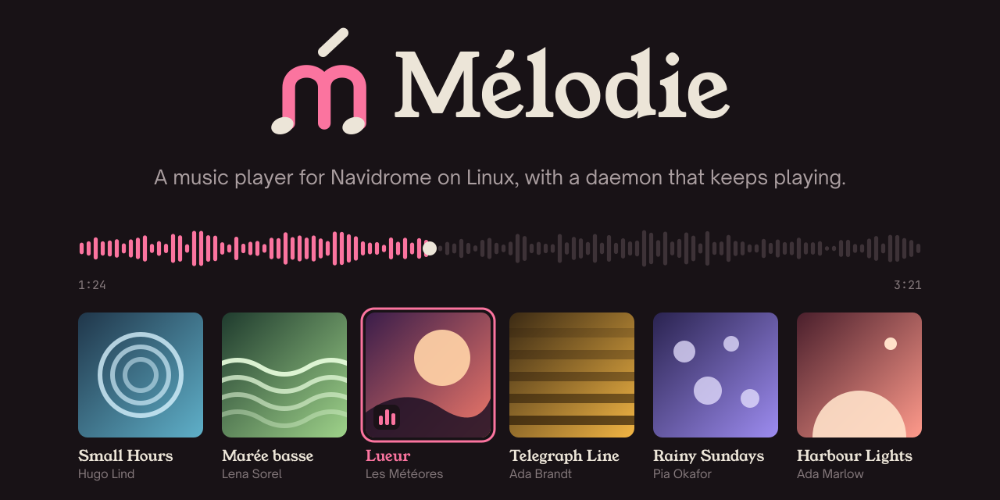
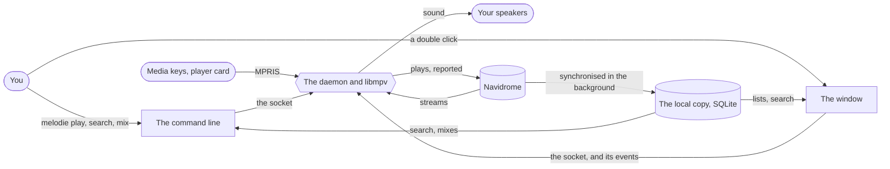
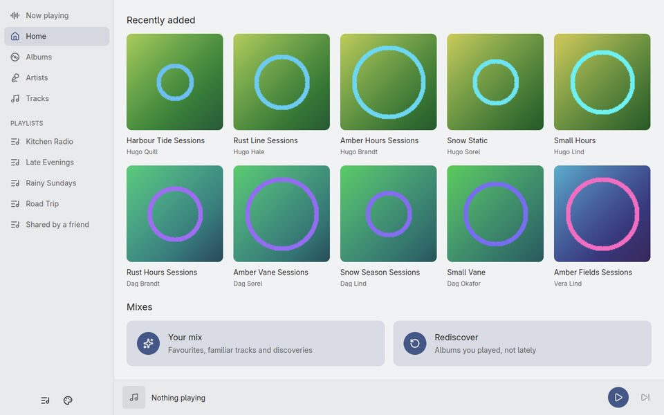
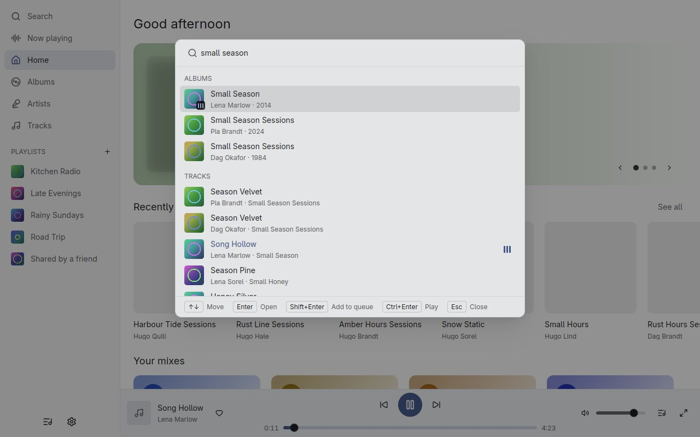
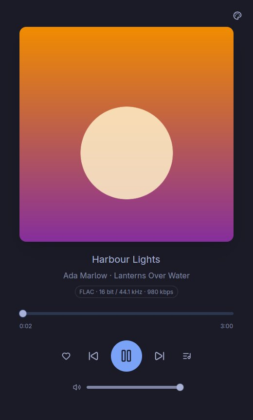

<div align="center">



[](https://github.com/KristenJestin/melodie/releases/latest)
[](https://github.com/KristenJestin/melodie/actions/workflows/ci.yml?query=branch%3Adev)

</div>

## What it is

A music player for a [Navidrome](https://www.navidrome.org) server (Subsonic / OpenSubsonic API,
tried on Navidrome 0.63) on Linux (Wayland), written in Rust.

One program plays: a small daemon that holds libmpv, starts on the first `play` and quits after ten
minutes of silence. Everything else is a client of it: the command line, the window
(`melodie-desktop`), the desktop's media keys and player card through MPRIS. Closing the window
never stops the music, and opening it shows what plays at once. It is early development, and three
choices shape it:

- **A local copy of the library.** Mélodie keeps the library in SQLite on your machine and keeps it
  up to date in the background. A search never touches the network and answers in a few
  milliseconds, accents and case aside (`nui bla` finds *Nuits blanches*).
- **Mixes computed locally**, after Symfonium's method: a personal mix balancing what you like, what
  you know and what you have never heard, rediscoveries, and instant mixes from a track, an album,
  an artist or a genre. Artists and albums are spread out, and tracks you skipped lately are left
  out. There is no radio, on purpose.
- **Secrets stay put.** Your password exists only while `melodie login` computes the Subsonic token;
  the token lives in the keyring (Secret Service), never in a file, a log or an output.

## How it works



1. **You log in once** with `melodie login` (or from the window). A first copy of the library starts
   in the background; later updates only read what changed, every half hour.
2. **You ask for music**: a search, an album, a playlist, a mix, from the terminal, the window, a
   launcher or a `melodie:` address. The first `play` starts the daemon.
3. **The daemon plays**: it streams from the server through libmpv, keeps the queue, reports plays
   to the server, remembers what you skipped, and tells every client what it does, one event per
   line.
4. **You close everything** and the music goes on; after ten minutes without music the daemon
   quits by itself.

## The pieces

- **The command line** (`melodie`): login, search, play, queue, controls, likes, playlists, mixes.
  Its `--json` outputs are a contract read by desktop launchers and a voice assistant.
- **The daemon** (`melodie daemon`, started for you): libmpv for the sound, MPRIS for the desktop, a
  Unix socket for control and events, ReplayGain, scrobbling, the skip memory.
- **The window** (`melodie-desktop`): a player after Amberol (a large cover, few buttons), a library
  after Feishin (large smooth lists, pages, a queue beside them, a waveform progress bar), a search
  palette on Ctrl+K, playlists with their duplicates, mixes, and the sign-in. Native, drawn on the GPU
  with GPUI and gpui-kit, at the full rate of the screen; it follows the Omarchy theme where there is
  one.
- **The library** (`melodie-core`): the Subsonic client, the local copy and its synchronisation,
  search, mixes, the keyring store and the socket protocol, shared by both programs.

## Screenshots

Made with invented data, like every capture of [docs/window](docs/window).

| The home of the window | The search palette | The player, Omarchy theme |
| --- | --- | --- |
|  |  |  |

## Install

No build needed: a release is an archive of the Releases page of this repository,
`melodie-<version>-linux-x86_64.tar.gz` with its `.sha256`, holding `melodie`, `melodie-desktop`,
`melodie.desktop`, its icon `melodie.svg` and `install.sh`. It is built on Ubuntu 24.04 for Linux x86_64 and needs glibc 2.39 or newer.

- **A release** (`vX.Y.Z`) is made when `dev` is merged into `main`.
- **The beta** (`vX.Y.Z-beta.N`, marked pre-release) is made at every push to `dev`, and only the
  newest one exists. It is the patch after the last release, so it is newer than it.

The system must provide **libmpv** (`libmpv2` on Ubuntu, `mpv` on Arch) and a Secret Service
(GNOME Keyring, KeePassXC…) for the login. The window links libxkbcommon (with its X11 part) and loads Wayland or X11 and a Vulkan driver when it
starts: a desktop has them.

In an empty folder, with `<tag>` the release (`v0.1.0`) or the beta (`v0.1.1-beta.21`) shown on the
Releases page:

```
gh release download <tag> -R KristenJestin/melodie --pattern 'melodie-*'
sha256sum --check melodie-*.sha256
tar -xzf melodie-*.tar.gz
cd melodie-*-linux-x86_64
./install.sh
```

Without `gh`, download the two files from the Releases page in a browser and run the same commands
from `sha256sum` on. `install.sh` copies the two programs into `~/.local/bin` (or `$PREFIX/bin`),
after `melodie quit` if a player was running, so that the next `melodie play` starts the new one.
It also installs the desktop entry `melodie.desktop` (it launches `melodie-desktop`, so that the
window is found by launchers, and by desktops from MPRIS's `DesktopEntry`) into
`~/.local/share/applications` (or `$PREFIX/share/applications`), creating the folder if needed, and
refreshes the desktop database when `update-desktop-database` exists. The icon that entry names, `melodie.svg`, goes into
`~/.local/share/icons/hicolor/scalable/apps` (or `$PREFIX/share/icons/hicolor/scalable/apps`), and the icon cache is refreshed when
`gtk-update-icon-cache` exists. A tool that is missing or fails never fails the install. It never asks for root and never touches your configuration, your local copy of the library or your
keyring entry. `~/.local/bin` must be in your `PATH`. `melodie --version` and
`melodie-desktop --version` tell which version is installed.

To update, do the same with the newer archive. To remove Mélodie: `melodie quit`, then delete the
two programs from `~/.local/bin`, `melodie.desktop` from `~/.local/share/applications`, and `melodie.svg` from
`~/.local/share/icons/hicolor/scalable/apps`; `~/.config/melodie`, `~/.cache/melodie`, `~/.local/state/melodie`
and the keyring entry (`service=melodie`) are yours to delete or keep.

## Build and layout

```
cargo build            # libmpv (libmpv-dev, mpv) is needed to build and to play
cargo test
```

A Cargo workspace under `crates/`:

- `melodie-core`: what every Mélodie program shares: Subsonic client, local copy, synchronisation,
  search, mixes, playlists, likes, covers, the keyring store, the socket protocol and the saved
  preferences. Its `fake` feature exposes the fake local server the tests talk to.
- `melodie`: the program: command line, daemon (libmpv), MPRIS, desktop notifications and the
  background synchronisation launcher.
- `melodie-desktop`: the window (gpui-kit on GPUI Fast, see [docs/gui-toolkit.md](docs/gui-toolkit.md)).
  A program of its own, so that the command line stays small and quick to start and does not pay
  for the window's build. Its first build is long (several minutes); without the default
  `gpui-fast` feature it builds on upstream GPUI from the same source.

The tests never touch a real server, real sound, the session bus, the keyring or the real
configuration (see `AGENTS.md`). The daemon integration test starts its own private
`dbus-daemon`: it must be installed, or the MPRIS checks are skipped with a message.


## Reference

Every command, option and file is described in [docs/reference.md](docs/reference.md): the
commands, the window, `melodie:` addresses, the daemon, favourites and playlists, mixes, files,
connection states, the local copy, automatic synchronisation, the JSON results, launcher covers and
security. The event stream and the socket requests are in [docs/events.md](docs/events.md).

## Contributing

The work is tracked in the issues; `dev` is the integration branch and the target of every pull
request. Coding agents, and anyone working like them, read [`AGENTS.md`](AGENTS.md). The logo and
the social preview are in [`assets/brand`](assets/brand).
