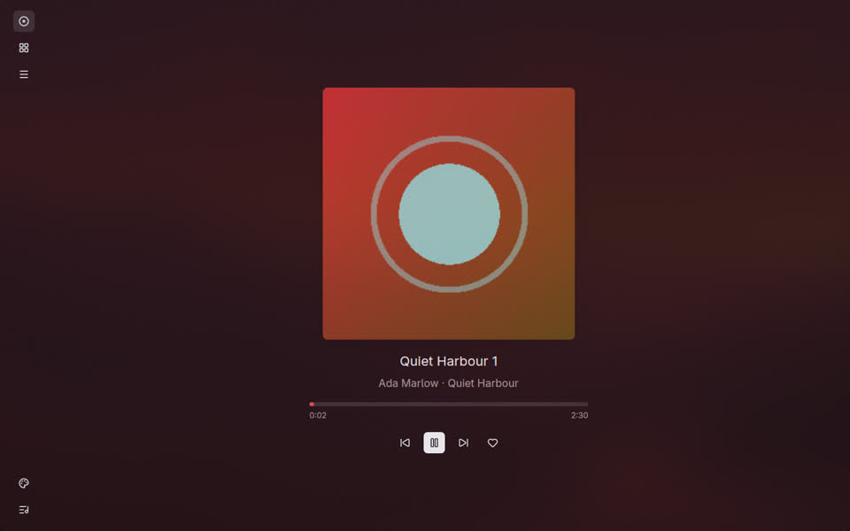
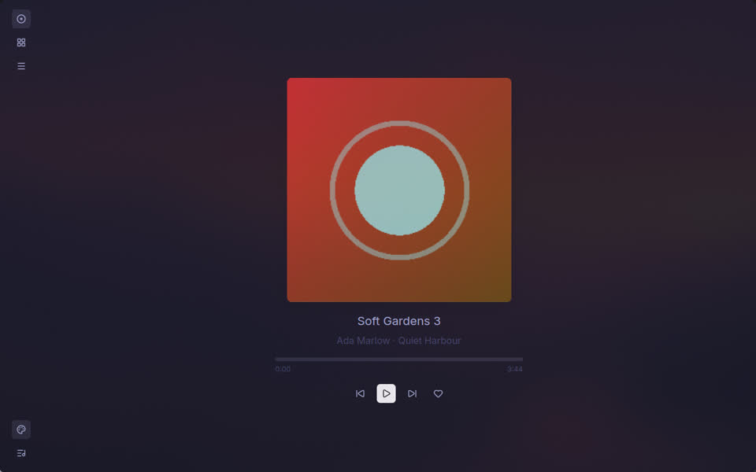
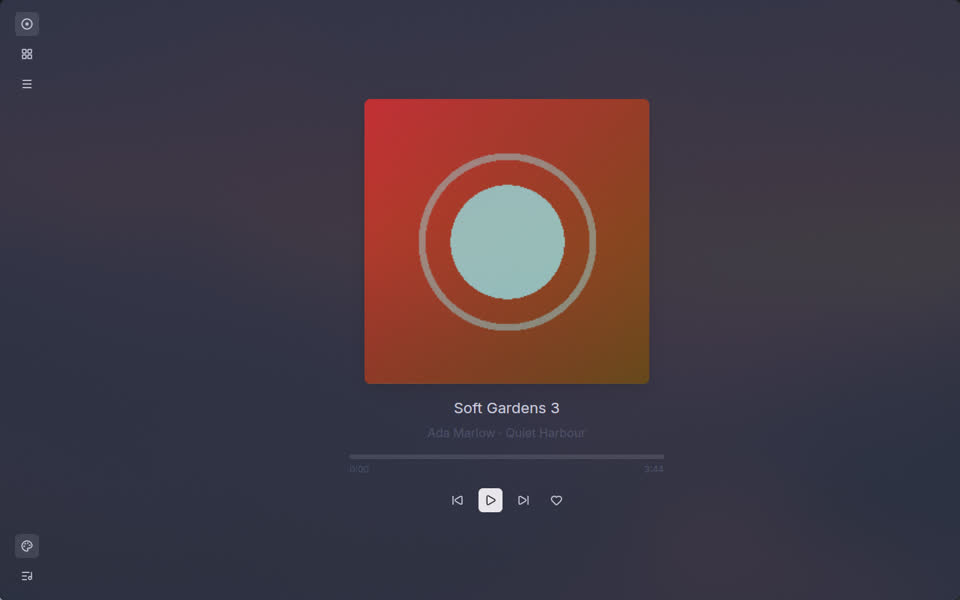
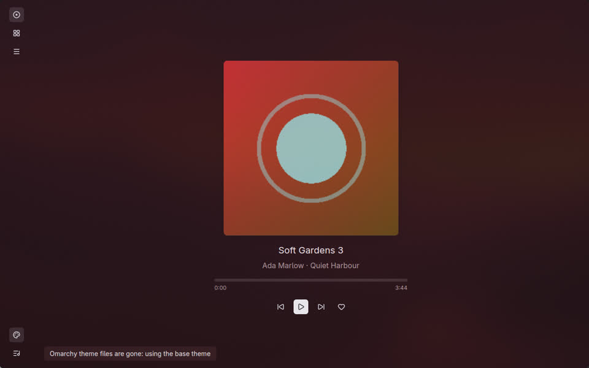
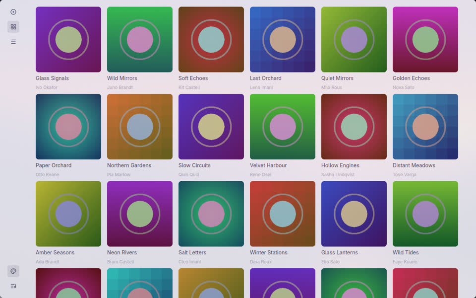
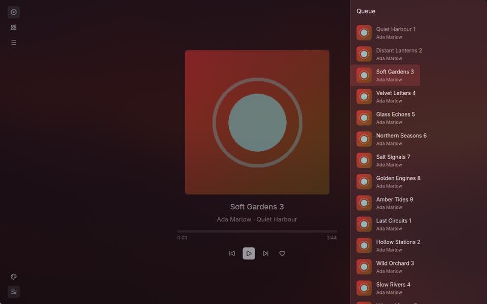
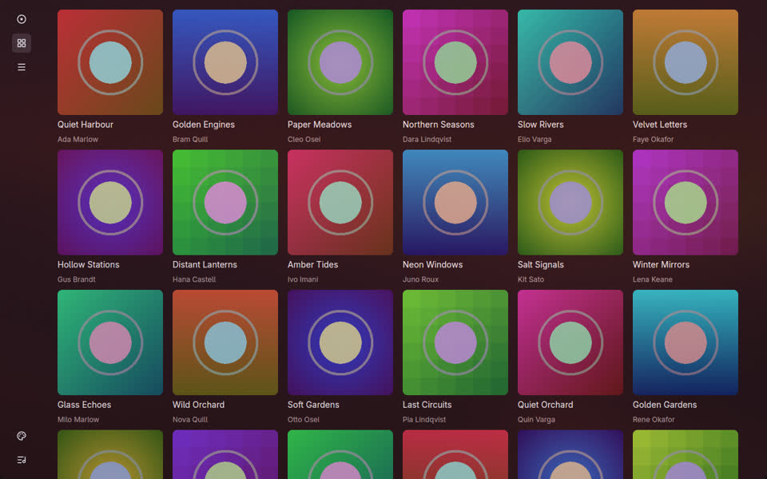
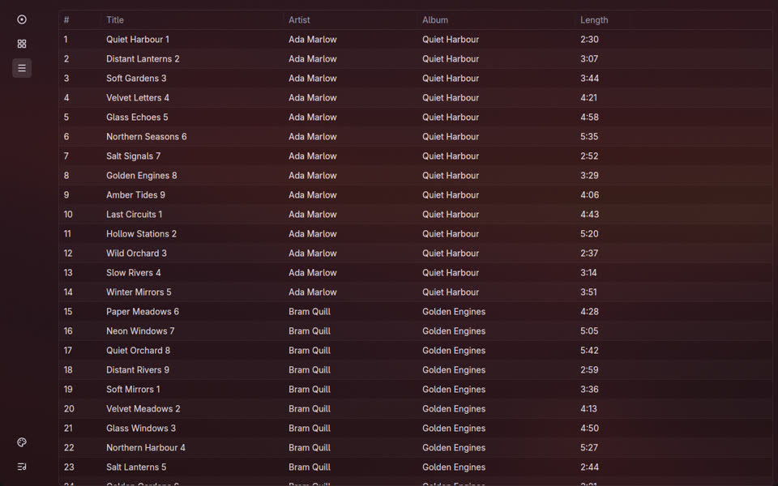

# The window toolkit: gpui-kit on GPUI Fast, and how the window follows the theme

Research for issue #7. The toolkit was chosen before the research started (gpui-kit running on
GPUI Fast); the question became "does this stack give a smooth, clean, well animated window, and
how do we build on it". The comparison with GTK4, iced or Slint that the first version of the issue
asked for was dropped when the issue was rewritten, and is not done here.

## Verdict

**Go on with gpui-kit on GPUI Fast, through gpui-kit's own `gpui-fast` Cargo feature, pinned, with a
one-line way back to upstream GPUI.** Nothing measured or read breaks the plan. Three things are
not proven and must be settled in the first window ticket (#8), not assumed:

1. **Scrolling a long list under real wheel events on GPUI Fast.** My scrolling benchmark moved the
   scroll offset by hand, which defeats Fast's scroll layers (see "Frame times"). The
   wheel-driven passes I planned were not run (see "What was not measured"). On the offset-driven
   run Fast was better on the table and worse on the cover grid; I cannot say which way the real
   result goes.
2. **The recordings of the animations.** None was made.
3. **A headless way to run window benchmarks.** GPUI opens real windows; the one headless try (a
   nested Weston) failed because it exposes no seat, and GPUI panics without one.

What I can say with measurements: both builds hold 165 frames per second while animating (panel
sliding, cover cross-fade, theme change) and while scrolling, apart from a few missed frames; a
window left open with only a position bar ticking costs under 1 % of a core on both; an animation
requested on every frame (a bar that moves smoothly) costs 12 to 14 % of a core, so the bar must
tick instead. GPUI Fast roughly halves the main-thread time of a mostly idle frame (0.29 ms against
0.55 ms), and is within noise of upstream on animations.

The route I recommend for GPUI Fast is the feature, not the `[patch]` of the `compat/` crates: the
feature is how gpui-kit 0.7.3 itself selects Fast, it moves in lockstep with gpui-kit, and Cargo
cannot silently keep upstream (the failure mode the issue worried about). The `[patch]` route
resolves too; it is described below and was not built.

## What was built and how it was measured

A throwaway prototype, outside the repository: one binary on invented data.

- 600 albums with generated 256 x 256 PNG covers (decoded on demand by GPUI), 8 000 tracks of
  invented titles.
- A player view (large cover, title, position bar, buttons), a cover grid, a track table
  (gpui-component's virtualised `DataTable`, 5 columns), a queue panel that slides in from the
  right, a rail of buttons.
- Colours: a base palette derived from the cover (animated between tracks), or the palette of an
  Omarchy `colors.toml` read from a file I could edit, watched live.
- The same source builds against upstream GPUI and, with `--features fast`, against GPUI Fast.
  Scripted scenarios drive it and print one line of statistics.

How the numbers were taken:

- Release builds (`cargo build --release`, default profile, no LTO, not stripped), built at
  `nice -n 19 -j 6`.
- The frame statistics come from GPUI's own frame trace (`gpui::profiler`, the `profiler` feature
  of gpui-kit, the same data `gpui-fps` shows): `Window::draw` duration (main-thread CPU for
  request-layout, prepaint and paint, not the GPU), and the intervals between presented frames.
  A *missed* frame is counted when two presented frames are two or more refresh intervals apart
  (one missed per extra interval). The first second of each run is dropped.
- Process CPU is `utime + stime` of the whole process from `/proc/self/stat` over the whole run
  (so it includes the GPU driver threads), as milliseconds of CPU per second of wall time.
- A desktop with a discrete NVIDIA GPU, Wayland (Hyprland 0.56), a screen
  refreshing at 165 Hz. The machine was in use by other work during the runs
  (load average 4 to 12 on 16 cores): treat every number as indicative. Each figure below is
  **one run** of a few seconds, not a median; the runs of two builds were taken one after the
  other.
- GPUI limits an *unfocused* window to about 30 fps (see "Traps"): the benchmark windows were not
  focused, so the benchmark sets `WindowOptions::inactive_frame_interval` to `None`. A first set
  of runs without it showed 27 fps animations and was discarded.
- Scrolling was driven by setting the list's scroll offset and calling `cx.notify` on its view
  once per frame, the same two things GPUI's wheel handler does (`offset += delta;
  cx.notify(current_view)`), not by real events. GPUI Fast's documentation says its scroll layers
  recognise a scroll by the wheel listener, so this emulation probably bypasses them.

## The stack: packaging and pins

| Piece | Version used | Pins |
|---|---|---|
| `gpui-kit` | 0.7.3 (crates.io) | re-exports GPUI, `gpui-component` (styled), `gpui-base` (unstyled) |
| GPUI (upstream route) | `gpui-pre` `=0.3.9`, a snapshot of Zed at `93d7456` (10 October 2026) | exact (`=`), every `gpui-pre-*` crate together |
| GPUI Fast (feature route) | `gpui-fast` 0.1.7 and its platform crates, all 0.1.7 | caret, chosen by gpui-kit's `gpui-fast` feature |
| GPUI Fast (patch route) | git, revision `231f2cd339e96a9105d0d3b160b7c04ba358c762` (12 October 2026) | `compat/` crates versioned `0.3.9` to match gpui-kit's `=0.3.9` |

gpui-component's components covered every view of the prototype.
The prototype uses gpui-kit (gpui-component comes through it). I did not look at `guise`, the second
GPUI option the issue mentions, since the toolkit is chosen; Vitesse is described in the issue as an
earlier name of gpui-kit. gpui-kit pins GPUI exactly (`=0.3.9`).

Longbridge maintains all three (gpui-kit, gpui-fast and the `gpui-pre` snapshots). GPUI Fast was
created on 24 September 2026; v0.1.0 came out on 6 October and v0.1.7 on 12 October. 

### The feature route

```toml
[dependencies]
gpui-kit = { version = "=0.7.3" }          # upstream GPUI

[features]
fast = ["gpui-kit/gpui-fast"]              # GPUI Fast, same source
```

`gpui-base` then does `extern crate gpui_fast as gpui;`, so no import changes. `cargo tree` still
lists `gpui-pre v0.3.9` (it stays in the graph, unused); the proof that Fast is what is linked is in
the binary: `gpui-fast-0.1.7` appears in the Fast build, no `gpui-pre-0.3.9` / `gpui-pre-linux` path
appears in it, and the two environment
knobs `GPUI_VIEW_RETENTION` and `GPUI_SCROLL_LAYERS` exist only in that binary.

### The patch route (resolved, not built)

```toml
[patch.crates-io]
gpui-pre          = { git = "https://github.com/longbridge/gpui-fast", rev = "231f2cd339e96a9105d0d3b160b7c04ba358c762" }
gpui-pre-platform = { git = "https://github.com/longbridge/gpui-fast", rev = "231f2cd339e96a9105d0d3b160b7c04ba358c762" }
gpui-pre-macros   = { git = "https://github.com/longbridge/gpui-fast", rev = "231f2cd339e96a9105d0d3b160b7c04ba358c762" }
gpui-pre-sum-tree = { git = "https://github.com/longbridge/gpui-fast", rev = "231f2cd339e96a9105d0d3b160b7c04ba358c762" }
```

With gpui-kit 0.7.3 this resolves: `cargo tree -i gpui-pre` shows `gpui-pre v0.3.9 (https://github.com/longbridge/gpui-fast?rev=231f2cd3…)`
under `gpui-base`, `gpui-component` and `gpui-kit`, and `cargo generate-lockfile` prints no warning.
When I also listed `gpui-pre-reqwest-client` (not used by this graph) Cargo printed
`warning: patch … was not used in the crate graph`: that is the warning to watch for, and it is
the only sign Cargo gives when a version drifts. This route also needs `extern crate gpui_kit as
gpui;` at the crate root because that route makes the `gpui` name resolve to the patched crate only through it. I did not compile
it: the feature route does the same job with less to maintain.

## Animations

GPUI itself has `with_animation` (`AnimationExt`: duration, easing, a closure from progress to
style; one-shot or repeating; frames requested only while it runs). gpui-base adds, in
`gpui_kit::base`:

- `transition(id, target, Transition::new(duration).ease(f), window, cx) -> value`: keyed state
  per `(element id, "channel")`; the first call adopts the target without animating; when the
  target changes mid-way the animation restarts **from the value sampled at that instant**, so
  interruption is smooth. Works for `f32`, `Pixels`, `Hsla`, points, sizes.
- `spring(...)`: same keying, keeps position *and velocity* on retarget; for values that change
  faster than the motion lasts. (Read in the source, not used in the prototype.)
- `Presence` (enter / present / exit lifecycle), `Sequence`, `animate_keyframes` and a set of easings
  (`ease_out_cubic`, …). I did not check whether they honour a reduced-motion setting.

What the prototype animated, all with these and all interruptible except the one-shot enter:

| Animation | Mechanism | Duration |
|---|---|---|
| View enters (fade + 14 px rise) | `with_animation` keyed by a view generation counter | 240 ms |
| Queue panel slides in and out | `transition` on a 0..1 offset, panel positioned with `right(px(-w * x))` and a fading scrim; unmounted at 1.0 | 280 ms |
| Cover and background tint change on track change | `transition` on the **queue position as an `f32`**: the two neighbouring covers are stacked, the upper one at the fractional opacity; the palette is mixed by the same fraction | 420 ms |
| Switch between base and Omarchy palette | `transition` on 0..1, `Palette::mix` | 320 ms |
| Cover hover (veil and accent ring) | `transition` per visible cell, keyed `(("album-hover", ix), "h")` | 140 ms |

Using the queue position as the animated value was the neat way to get an interruptible
cross-fade: two track changes 150 ms apart simply move the value on to the new target. Hover and
press states of gpui-component buttons are GPUI style modifiers (`hover`, `active`) and change
instantly; an animated hover needs a keyed `transition` as above. I found no scale-on-hover for
ordinary elements.

**Retained mode and animations.** GPUI Fast's rule is that a view is rebuilt when an entity it
read changed and was notified, or a global it read was written, or a tracked `ListState` /
`ScrollHandle` moved. An animation notifies its view every frame, so that view is rebuilt every
frame while it runs, and views around it are replayed. Nothing stale showed in the prototype's
animations (checked by eye on screenshots, not by an oracle). Two things from its docs to design
around: an animation requested *inside* a list row (a hover fade) keeps that list off its scroll
layer while it runs, and a view that holds a list and also asks for animation frames outside the
list's content loses the layer; so keep a list in a view of its own and the animating pieces in
sibling views.

**Scrolling feel.** On Wayland GPUI applies a wheel or touchpad delta immediately
(`scroll_offset += delta; cx.notify(view)`): no easing, no inertia. GPUI's `gestures.rs` has
momentum, but only for touch; gpui-base's `ScrollBounce` is an edge bounce. "Scrolling with
momentum", wanted in the issue, is therefore not provided and has to be written (intercept the
wheel, move a target offset, ease towards it with a `spring` per frame). That is a small piece of
code but also exactly the kind that interacts with Fast's scroll layers (every eased frame is a
scroll-only frame, which is what the layers are for); it belongs to #9.

## Frame times

Release builds, one run each, `inactive_frame_interval = None`, screen at 165 Hz (6.06 ms per
frame). "n.m." means not noted. `draw` is `Window::draw` on the main thread (mean / p99). `CPU` is the whole process.
`fps` is presented frames per second over the run. "Upstream" is upstream GPUI (`gpui-pre` 0.3.9),
"Fast" is GPUI Fast 0.1.7 through the feature.

| Scenario | Upstream: draw mean / p99 | Fast: draw mean / p99 | Upstream: fps, CPU | Fast: fps, CPU |
|---|---|---|---|---|
| Idle, position tick 4 Hz, bar in its own view | 0.55 / 0.86 ms | 0.29 / 0.62 ms | 4, 7-9 ms/s | 4, 6 ms/s |
| Idle, tick 4 Hz, position kept in the **shared model** | 0.56 / n.m. | 0.52 / n.m. | 4 | 4 |
| Bar redrawn on **every frame** (animation) | 0.50 / n.m. | 0.27 / n.m. | 165, 143 ms/s | 165, 115 ms/s |
| Cover grid, 600 covers, scrolled by offset (cold) | 1.72 / 2.77 ms | 2.26 / 6.20 ms | 165, 378 ms/s; 0.3 % missed | 159, 434 ms/s; 3.4 % missed |
| Cover grid, covers already decoded (`--prewarm`) | 1.83 / 3.0 ms | 2.11 / 6.3 ms | 0.3 % missed | 4.4 % missed |
| Track table, 8 000 rows, scrolled by offset | 3.17 / 5.00 ms | 1.63 / 3.28 ms | 157, 577 ms/s; 4.6 % missed | 163, 336 ms/s; 1.5 % missed |
| Queue panel slides in and out (280 ms every 600 ms) | 1.14 / 1.96 ms | 0.76 / 1.48 ms | about 80 frames/s averaged (165 while sliding), 130 ms/s | same, 106 ms/s |
| Same, reversed after 140 ms | 1.07 / 1.76 ms | 0.83 / 1.84 ms | 124 ms/s | 108 ms/s |
| Cover cross-fade on track change | 0.64 / 1.08 ms | 0.60 / 1.63 ms | 91 ms/s | 87 ms/s |
| Switching between the three views | 1.83 / 4.53 ms | 1.65 / 6.28 ms | 145 ms/s | 128 ms/s |
| Switching base / Omarchy palette | 0.65 / 1.10 ms | 0.72 / 2.36 ms | 72 ms/s | 80 ms/s |

(The animation rows are averages over runs where an animation is active a fraction of the time.)

How to read it:

- **Idle is cheap on both**, which is the case that matters for a window left open for hours:
  four frames a second, under one millisecond each, about 1 % of a core. Fast halves the draw time
  of those frames, but only when the ticking position lives in a small view of its own; with the
  position in the shared model Fast loses most of the gain (0.52 ms), because every view reading
  the model is rebuilt on each tick.
- **A bar redrawn on every frame is not cheap** (12 to 14 % of a core, for ever). Tick it four times
  a second: a 420 px bar over a 3 minute track moves two pixels a second.
- **The table**, with the offset emulation, is better on Fast (about half the main-thread time and
  CPU). **The grid is worse on Fast**, with more frames missed (3 to 4 % against 0.3 %): its rows
  are stacks of images, labels and a hover animation per cell, which is the case the scroll-layer
  document says keeps a list off its layer, and the offset emulation probably defeats the layers
  anyway. I could not tell the two apart. This is the number to redo with real wheel events.
- The few missed frames on the table (4.6 % on upstream) are probably the machine's load, not the
  toolkit, but I only have one run to say it.

### Memory, build time, binary

| | Upstream | Fast |
|---|---|---|
| Resident memory, idle, covers not yet seen | 176 MB | 177 MB |
| After scrolling through all 600 covers (decoded, 256 x 256) | 340 MB | 360 MB |
| Resident memory with the 8 000-row table | 181 MB | 195 MB |
| Clean release build, `-j 6`, `nice -n 19` | 14 min 24 s (dependencies only, under contention), 8 min 40 s (second full build) | 8 min 12 s |
| User CPU of that build | about 2 680 s | about 2 680 s |
| Incremental, after touching `main.rs` | 5 to 30 s | 5 to 30 s |
| Release binary, not stripped, all icons embedded | 55.1 MB | 58.0 MB |

Memory grows by about 160 MB for 600 decoded covers: GPUI keeps decoded images. The real window
must ask the server for covers at the displayed size (Subsonic `getCoverArt` takes `size`), not
decode 1 000-pixel originals.

## What breaks or is missing in gpui-kit for our views

Nothing blocked the prototype. Gaps and traps found:

- **No drag to reorder rows.** The table moves columns only. The queue (#8) needs `on_drag` /
  `on_drop` written on GPUI's primitives (the theme has `drag_border` and `drop_target` colours).
- **No cover placeholder or fade-in** for images: an `img` is empty until decoded.
- **Icons are not loaded by default**: without `.with_assets(gpui_kit::assets::AllAssets)` on the
  application, icon buttons show empty squares. `gpui_component::IconName` is a subset; the whole
  Lucide catalogue is `gpui_kit::assets::IconName`. `AllAssets` embeds all of it; embed only what
  the window uses.
- **Theme API**: `Theme::change(mode)` reloads the colours, so edit colours in a second
  `Theme::update`. Setting `background`, `table`, `list` to transparent lets the window's own
  (animated) background show through the table and lists.
- **`FluentBuilder`** (`when`, `when_some`) is not in `gpui_kit::*`: `use gpui_kit::prelude::FluentBuilder as _;`.
- **Edition 2024**: `gen` is a reserved word (a "view generation" variable must be named otherwise).
- Reading the model in `render` and then calling `transition(..., cx)` is a borrow conflict: take a
  small snapshot (`Arc`s and copies) first.
- **Not exercised**, so unknown: the slider (position drag, volume), dialogs and context menus,
  keyboard navigation, accessibility, fractional scaling, the client-side
  window decoration on Wayland, pointer drag of the scrollbar.

## Upgrading gpui-kit with GPUI Fast behind it

With the feature route gpui-kit decides which `gpui-fast` it builds with, so an upgrade of gpui-kit
carries a matching Fast; `Cargo.lock` is the pin. Expect a GPUI API change at every `gpui-pre`
snapshot (gpui-kit pins them exactly). With the patch route an upgrade is a manual step: Fast's `compat/` crates must carry
the version gpui-kit pins (`0.3.9` today), and when they do not Cargo prints the "patch was not
used" warning and silently keeps upstream: a CI step that fails on that warning, or that checks
`cargo tree -i gpui-fast`, is required if that route is ever used.

## Going back to upstream GPUI

With the feature route: drop the feature (`gpui-kit` without `gpui-fast` is upstream GPUI, the
default), provided the window crates import only through `gpui_kit::*`, never `gpui_fast::`, and
use none of Fast's own APIs (anything imported from `gpui_fast` directly). One line plus a rebuild;
the prototype builds both ways from the same source, which is the test. What is lost: retention
(the halved idle frame) and the table's scroll layers. If the window used `with_animation` and the
rule "state a view reads lives in entities" from the start, there is nothing else to undo.

## Following the theme

### The choice

The theme is a setting with two values, `base` and `omarchy`.

- **base**: always available. Amberol-like: the window background, accent and text colours are
  derived from the cover's hue (the prototype's `Palette::base(hue)`), animated when the track
  changes.
- **omarchy**: offered only when Omarchy is detected *and* its palette file exists and parses.
  Colours from that file; the cover does not tint the window.
- **First launch** (no stored choice): `omarchy` when it is offered, else `base`.
- **Stored**: the choice only, in a file the window owns, `~/.local/state/melodie/window.toml`
  (`theme = "base" | "omarchy"`). An absent key means "never chosen", which is what makes the first
  launch default work. A file of its own, not `state.toml`: the daemon rewrites `state.toml` for the
  volume, and two processes rewriting one file lose each other's keys.
- **If the files go away** while `omarchy` is chosen: fall back to `base` for as long as they are
  missing, say so in the window ("Omarchy theme files are gone: using the base theme"), keep the
  stored choice, and take the palette back when the files return.

### What proves we are on Omarchy

Two facts, both required (as the issue asks):

1. `/etc/os-release` has `ID=omarchy`. Omarchy ships it as an override of the system file (`etc-overrides/os-release`, see Omarchy's
   [`docs/file-layout.md`](https://github.com/basecamp/omarchy/blob/4c1b4cb3a94447aff39af98e2fcc0490a9fb32e7/docs/file-layout.md)).
   It is the proof of "this is the operating system"; it does not depend on how the program was
   started. `OMARCHY_PATH` is not used: it is set by login shells and the Hyprland session, not for
   a program started from a service.
2. `$XDG_STATE_HOME/omarchy/current/theme/colors.toml` (default `~/.local/state/omarchy/...`) can be
   read and has `background`, `foreground` and `accent`.

Either one alone is not enough: a bare `colors.toml` could be left over, and an Omarchy machine in
the middle of a theme change has no file for a moment.

### Which file is the contract: `colors.toml`

| | `…/current/theme/colors.toml` | A template in `~/.config/omarchy/themed/*.tpl` |
|---|---|---|
| Written by | Omarchy, on every theme change | us, once, into the user's own configuration directory |
| Documented | yes, [`docs/theming.md`](https://github.com/basecamp/omarchy/blob/4c1b4cb3a94447aff39af98e2fcc0490a9fb32e7/docs/theming.md) ("`colors.toml` provides the palette keys used by templates"), and the manual's [theme chapter](https://github.com/basecamp/omarchy/blob/4c1b4cb3a94447aff39af98e2fcc0490a9fb32e7/manual/43-making-your-own-theme.md) | yes, as a way to theme other apps |
| Exists for every theme | 23 of 23 shipped themes have it with `mode`, `accent`, `selection`, `muted`, `background`, `dark_background`, `lighter_background`, `foreground`, `dark_foreground`; themes older than `colors.toml` get one generated from `alacritty.toml` | only after our install step, and only rendered at the *next* theme change |
| Used by Omarchy itself | its shell reads it ([`shell/Commons/Color.qml` line 230](https://github.com/basecamp/omarchy/blob/4c1b4cb3a94447aff39af98e2fcc0490a9fb32e7/shell/Commons/Color.qml#L230)); every built-in template is rendered from it | no |
| Writes outside our own files | none | yes, in the user's Omarchy configuration |

`colors.toml` is the sturdier contract: the theme system's own input, present for every theme,
read-only for us, nothing to install and nothing to repair after an Omarchy upgrade.
A template (`mix`, `_rgb` placeholders, `{{ background }}` …) would only give us the same values
in a format of our choosing, at the cost of writing into `~/.config/omarchy/` and of a window that
shows nothing until the next theme change. The only advantage is the placeholder syntax, which a
`toml` parser makes unnecessary. Caveat: `colors.toml` is documented as the template palette, not
promised as a public API; the keys can change. The window therefore requires only three keys and
derives the rest.

Keys used by the prototype: `background`, `foreground`, `accent` (required); `lighter_background`
(surface; else a mix of background and foreground), `muted` or `dark_foreground` (secondary
elements), `mode = "light"` (everything else is dark; a legacy `light.mode` marker file also
exists). **Do not use `muted` for secondary text**: Omarchy defines it for comments, placeholders
and dividers, and text built from it has low contrast; mix background and foreground instead.

### Following a change live

Omarchy's `omarchy-theme-set` builds the new theme in `current/next-theme` and then does
`rm -rf current/theme; mv current/next-theme current/theme`
([`bin/omarchy-theme-set`, lines 467-468](https://github.com/basecamp/omarchy/blob/4c1b4cb3a94447aff39af98e2fcc0490a9fb32e7/bin/omarchy-theme-set#L467-L468)).
Three consequences, all handled in the prototype and all tested by me against a **copy** laid out
the same way in a temporary directory, never against the real files:

- The file is replaced by a different directory, so a watch on the *file* is lost: watch the
  directory that contains `theme/` (`…/omarchy/current`), recursively.
- For a moment (between the `rm` and the `mv`) the file does not exist: a deletion event must not
  trigger the fallback by itself. Wait about 250 ms after the last event, then read the file; only
  a file that is still missing means "gone".
- Editors save through a temporary file and a rename: the same debounced re-read covers it.

The prototype used `notify` 8 (inotify), forwards events through a channel to a task on GPUI's
executor, and sets the model; the views follow because they read it. It cost nothing at idle (the
watcher sleeps in the kernel). The palette crossfades over 320 ms.

Observed in the prototype with the copy: a switch from Tokyo Night to Nord was followed live; the
copy was then removed (the window fell back to the base palette and showed the notice); then
Catppuccin Latte, a light theme, was put in place and applied. In the first screenshots below the
window follows a theme live; the third shows the fallback notice.











Other screens of the prototype:







(The screenshots use generated covers and invented titles. Omarchy's palettes shown are those of
shipped, public themes.)

## Conventions for the window crates

1. **One dependency, one import path.** The window crate depends on `gpui-kit` only, with a
   `gpui-fast` feature that is on by default and forwards to `gpui-kit/gpui-fast`. Code writes
   `use gpui_kit::*;` and never `gpui_fast::`. CI builds with and without the feature.
2. **State.** One `Entity<Model>` per window mirrors what the daemon says (current track, queue,
   play state, the chosen theme, the open view). Views are entities of their own and read the
   model; they do not copy it. Anything that changes more than once a second (the playback
   position) is in a **separate entity read by one small view**: measured, a tick in the shared
   model costs Fast 0.52 ms a frame instead of 0.29 ms.
3. **`cx.notify()`.** After `entity.update(...)`, notify the entity when something it renders
   changed. What a render reads outside entities (an `Rc<RefCell<…>>`, the time) needs a notify, or
   it shows what it showed when last built. Never notify or write a global from inside render,
   prepaint or paint, nor every frame: every view that reads it is rebuilt each frame. When a view
   looks stale, run with `GPUI_VIEW_RETENTION=0`: if it is then right, a notify is missing.
4. **Animation.** One small `motion` module holds the durations and easings (a view enter 240 ms,
   a panel 280 ms, a colour change 320 to 420 ms, a hover 140 ms, all ease-out cubic) and wraps
   `transition` and `with_animation`; no animation is written with a bare timer. Values that can be
   retargeted use `transition` (or `spring` when velocity matters); one-shot enters use
   `with_animation` keyed by a generation counter. Nothing calls `request_animation_frame` unless
   something is moving. Check how reduced motion
   is honoured before writing any hand-made frame request.
5. **Position bar and clocks tick**, they are not animated: four updates a second. Every time and
   count that changes in place is drawn in tabular digits (`figures::clock_text`, `count_text`,
   `.tabular()`: the `tnum` feature, which GPUI exposes as `font_features` and the window's font,
   Adwaita Sans, has), so a digit changing moves nothing.
6. **Lists.** Long lists are `uniform_list` or the `DataTable` (fixed row height), each in a view of
   its own. The one animation inside a row is the fade of what shows under the pointer (the row's
   buttons, the play button on a cover: `reveal`, `widgets::hover`): it runs for 110 to 160 ms
   when the pointer changes row, and asks for nothing the rest of the time. Covers are requested
   at the displayed size.
7. **Theme.** A `Palette` value (background, surface, text, secondary text, accent, dark/light) is
   the only thing the views use. The base palette is derived per track; the Omarchy one is read from
   `colors.toml`. The gpui-component `Theme` is written from the palette **once per theme change**
   (`Theme::change(mode)` then `Theme::update`), with transparent surfaces; the animated tint is
   computed in the views, from a snapshot of the model, with keyed transitions.
8. **Window options.** Set `inactive_frame_interval` to `None` (see below): the default drops an
   unfocused window to 30 fps, so an animation seen on a second screen while another window has
   the focus would be jerky. This costs nothing at idle, because frames are drawn only on demand.
9. **Release profile.** Strip the binary, embed only the icons the window uses, and decide on LTO
   after measuring: the prototype used the default profile.

## Traps

- **An unfocused window is capped at about 30 fps** (`WindowOptions::inactive_frame_interval`,
  default 33 ms), for frames that come from animation requests. A player that sits on a second
  screen is exactly that. Measure and record with the option on `None`.
- **GPUI benchmarks and recordings open real windows** on the session that runs them. They steal
  focus and, if they inject input, move the pointer. Run them in an environment of their own (see
  "What was not measured").
- GPUI's wheel handling has no inertia (above). Fast's scroll layers decide "this frame is a
  scroll" from the wheel listener; a scroll made by setting the offset is not recognised as one.
- gpui-kit's `application()` does not load icons; see above.
- **A key listener on an ancestor runs before the text field gets the key** (#10): GPUI matches
  the key bindings, then calls the `on_key_down` listeners from the root down and back up, and only
  then hands the character to the focused field. A window-wide shortcut on Space or `/` that stops
  the event swallows it from the field: check whether the field has the focus first.
- **The text field** is `gpui_kit::component::input::{Input, InputState}`: `InputState::new(window,
  cx).placeholder(..)` in an entity, `cx.subscribe_in(&state, window, ..)` for
  `InputEvent::Change`; `set_value` emits no `Change`. Its caret blinks by notifying the field's
  state: render the `Input` in a view of its own, or every blink rebuilds the view around it.

## What would make us regret the choice

- **GPUI Fast is young and has one maintainer organisation** that also maintains gpui-kit and the
  snapshots; if it stops following Zed or gpui-kit, we are on upstream GPUI behind a feature flag
  (cheap to take, see "Going back"), losing little we have measured.
- **Scroll layers turn out to do nothing for our lists** under real wheel events: then the case for
  Fast is the idle frame only, which is worth less than the exposure to a second young dependency.
  The first window ticket must measure that before relying on it.
- **GPUI API churn.** Each gpui-kit release moves the GPUI snapshot; pins are exact and upgrades
  are work, not a command.
- **Small ecosystem on Wayland**: client-side decorations, fractional scale, input methods and
  accessibility were not looked at here.
- **No inertial scrolling, no drag-to-reorder, no image placeholders**: all three are ours to write.
- **Cost**: 8 to 14 minutes for a clean release build on 16 cores and 55 to 58 MB binaries (before
  stripping and keeping only the used icons).

## What was not measured, and why

- **Real wheel-driven scrolling on Fast and on upstream.** I wrote the benchmark to inject real
  `ScrollWheelEvent`s through `Window::dispatch_event`, once per frame, which is the faithful way
  to exercise the wheel listeners, the scrollbar and the scroll layers. The passes I ran were taken
  while the machine was at a load of 30 to 47 (other work) and varied by a factor of three between
  repeats: unusable. The repeated passes were interrupted because the benchmark windows interfered
  with the person using the machine.
- **Recordings of the animations.** None was made, for the same reason. The scenarios exist in the
  prototype (view enter, queue panel with an interrupted reversal, cover and tint change with an
  interruption, scrolling, hover, theme switch) and should be recorded in an isolated session.
- **A headless run.** One try: a nested Weston (`--backend=headless`, its own runtime directory and
  socket). Weston headless has no input devices and offers no `wl_seat`, and GPUI panics at start
  (`Wayland compositor does not provide wl_seat`). Not tried: a nested compositor with a virtual
  seat (sway or labwc headless, `weston --backend=wayland` inside a dedicated session), or a
  machine of its own.
- **Equality of the two builds' output.** A harness grabbed screenshots at a fixed schedule for
  both builds; 13 of 14 captures were pixel-identical and the 14th differed by 85 dB PSNR. The
  harness lagged behind the scenario by about one state, so the captures are not labelled by the
  state they show, and this is weak evidence of "nothing stale", not a proof.
- **Statistics.** One run per figure.
- **Dropped frames at 165 Hz under real use.** Counted from presentation intervals, which include
  the compositor's own pacing.
- GPU time (only main-thread draw time and process CPU were measured).
- The `[patch]` route was resolved but not compiled or run.

## Reproducing

The prototype (not committed, it is thrown away) was `gpui-kit = "=0.7.3"` with
`features = ["profiler"]`, plus `image` (PNG), `notify` and `toml`; build with and without
`--features fast` (`gpui-kit/gpui-fast`). The measurement code is a small module around
`gpui::profiler::{set_trace_enabled, FrameTimingCollector, FrameEvent}` (draw start and end, present
end, refresh interval) and `/proc/self/stat`. A fake Omarchy for the theme tests is a temporary
directory with `current/theme/colors.toml` swapped the way Omarchy swaps it. Omarchy sources read:
revision `4c1b4cb3a94447aff39af98e2fcc0490a9fb32e7` (12 October 2026).
